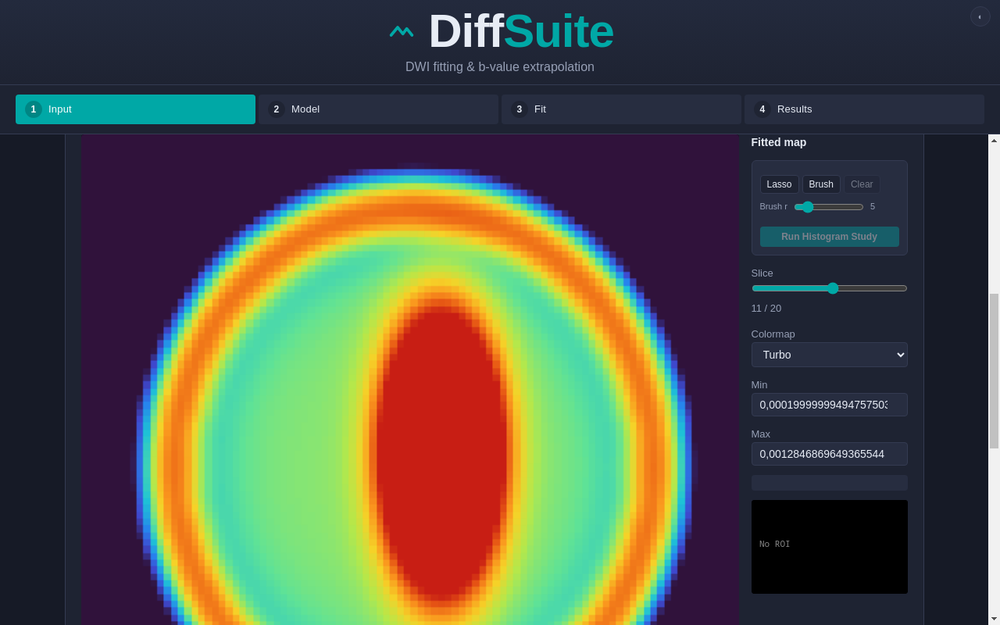
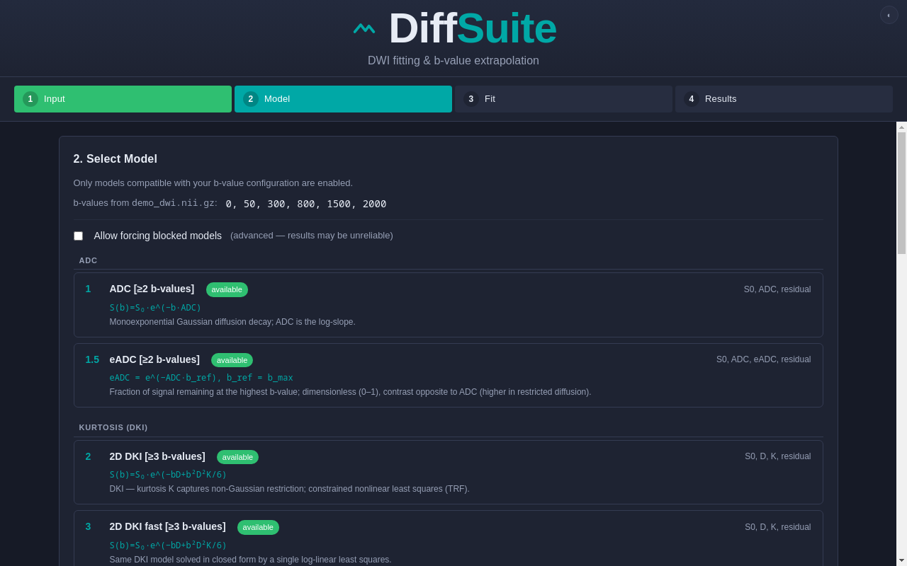

# DiffSuite

**Diffusion-weighted imaging (DWI) model fitting and b-value extrapolation for 4D NIfTI and DICOM data.**

DiffSuite is a modular Python toolkit for voxel-wise fitting of diffusion MRI signal models. It ships with a batch-friendly command-line interface, a FastAPI backend, and a full Electron + React + TypeScript desktop GUI with an embedded NIfTI viewer. Sixteen diffusion models are available — from simple ADC and DKI to IVIM, stretched-exponential DDC, DDVD vessel density, and experimental CTRW/FROC models — plus model-based synthetic signal extrapolation to arbitrary b-values.

> **Status:** research / engineering tool. Not a medical device and not intended for clinical diagnosis.

---

## Screenshots



*Embedded NIfTI viewer — here showing a fitted diffusion map with the turbo colormap, slice navigation, and the selection/histogram study tools.*



*Model selection — every compatible model is listed with its equation, b-value requirements, outputs, and a one-line explanation; incompatible models stay visible as blocked (or can be force-fitted).*

---

## Table of contents

- [Screenshots](#screenshots)
- [Highlights](#highlights)
- [Architecture](#architecture)
- [Supported models](#supported-models)
- [Installation](#installation)
- [Command-line usage](#command-line-usage)
- [Desktop GUI](#desktop-gui)
- [Building distributables](#building-distributables)
- [REST API](#rest-api)
- [Output files](#output-files)
- [Scientific background](#scientific-background)
- [Repository layout](#repository-layout)
- [Limitations and caveats](#limitations-and-caveats)
- [License](#license)

---

## Highlights

### Fitting engine

- **16 registered models** covering Gaussian diffusion, diffusion kurtosis, intravoxel incoherent motion (IVIM), stretched-exponential diffusion, vessel-density metrics, and experimental fractional models.
- **Voxel-wise fitting** over 4D volumes, slice by slice, with optional `ProcessPoolExecutor` parallelism.
- **Automatic model proposal** based on the b-values actually present in the acquisition — incompatible models are rejected with an explicit reason (and can be forced in the GUI).
- **ROI-restricted fitting** — draw an ellipse on the b0 reference and fit only those voxels.
- **b-value extrapolation** — use fitted parameter maps to synthesize the expected signal at any target b-value (e.g. b = 3000 s/mm²).
- **Automatic quality assessment** — residual-based, family-aware quality verdict (`good` / `fair` / `poor`), a 0–1 score, worst slices, and b-sampling hints.
- **Scalar ROI calculator** — fit a curated subset of models to ROI-mean `(b, signal)` pairs without loading a volume.
- **NIfTI and DICOM input** — `.nii`, `.nii.gz`, DICOM folders/files (via `dcm2niix`), with a `SimpleITK` fallback loader.

### Desktop GUI

- **4-step wizard** — Input → Model → Fit → Results.
- **Embedded canvas NIfTI viewer** with gray / turbo / jet colormaps, histogram-equalized windowing, and slice navigation.
- **Interactive ROI drawing** — drag to draw, move, and resize an ellipse; extrude across slices or keep a single slice.
- **Multi-b extrapolation UI** — select one or more target b-values and open each synthetic map in the viewer.
- **Voxel selection + histogram study** — lasso or brush a 3D voxel mask across slices, then run an in-browser histogram with Gaussian fit and scipy-matching statistics (mean, median, percentiles, std, skewness, excess kurtosis).
- **Model reference table** — every model shows its equation and a one-line explanation of the underlying principle.
- **Themes** — default, Gruvbox, and Cappuccin, persisted locally.
- **Thin Python backend** — the GUI calls exactly the same fitting code as the CLI through a local FastAPI server on `127.0.0.1:18923`.

---

## Architecture

```
┌──────────────────────────────────────────────────────────────┐
│  Electron renderer (React + TypeScript)                      │
│  wizard · NIfTI viewer · ROI editor · histogram study        │
└───────────────────────────┬──────────────────────────────────┘
                            │ HTTP (127.0.0.1:18923)
┌───────────────────────────▼──────────────────────────────────┐
│  FastAPI backend  (src/diffsuite/api.py)                     │
│  sessions · model proposal · jobs · ROI · extrapolation      │
└───────────────────────────┬──────────────────────────────────┘
                            │ Python calls
┌───────────────────────────▼──────────────────────────────────┐
│  Fitting core  (frontend.py · core.py · models/)             │
│  load NIfTI/DICOM · mask · group b-values · fit · save maps  │
└──────────────────────────────────────────────────────────────┘

CLI (`diffsuite`) ─────────────────────────────────────────────┘
                    same frontend.py / core.py / models/
```

The GUI does **not** reimplement any mathematics. It is a presentation layer over the same Python functions used by the CLI.

---

## Supported models

Models are registered in `src/diffsuite/models/__init__.py` (`MODEL_REGISTRY`). Each key maps to a `fit_*_volume(...)` function that returns a dictionary of 3D parameter maps.

| Key | Model | Equation | Required b-values | Method |
|-----|-------|----------|-------------------|--------|
| `adc` | Apparent diffusion coefficient | `S(b) = S₀·e^(−b·ADC)` | ≥ 2 | Voxel, log-linear |
| `eadc` | Exponential ADC | `eADC = e^(−ADC·b_max)` | ≥ 2 | Derived from ADC |
| `dki2d` | Diffusion kurtosis (2D) | `S(b) = S₀·e^(−bD + b²D²K/6)` | ≥ 3 distinct b | Voxel, constrained TRF |
| `dki2d_fast` | Fast DKI | same as above | ≥ 3 distinct b | Voxel, closed-form log-linear |
| `dki2d_fast+` | Fast DKI plus | same as above | ≥ 3 distinct b | Adds intravoxel skew + fused maps |
| `dki_ais_u` | DKI AIS — unconstrained | same as above | ≥ 3 distinct b | Volume-level iterative (Yan 2014) |
| `dki_ais_c` | DKI AIS — constrained | same as above | ≥ 3 distinct b | Adds `D ≥ 0`, `K ≥ 0`, `K ≤ 3/(b_max·D)` |
| `dki_ais_sc` | DKI AIS — smoothed/constrained | same as above | ≥ 3 distinct b | CAIS + 3×3×3 ADC smoothing |
| `akc_adci` | Secant-based DKI approximation | `ADC(b_mid) ≈ D − (D²K/3)·b_mid` | ≥ 3 distinct b | Voxel, secant regression |
| `ddc` | Stretched exponential (DDC) | `S(b) = S₀·e^(−(b·DDC)^α)` | ≥ 3 + b0 | Voxel, bounded α ∈ (0, 1] |
| `ivim_seg` | IVIM — segmented | `S(b) = S₀[(1−f)e^(−bD) + f·e^(−bD*)]` | ≥ 4; ≥ 3 b > 200; ≥ 2 b < 200 | Two-stage voxel fit |
| `ivim_full` | IVIM — full nonlinear | same as above | ≥ 4; ≥ 2 b > 200; ≥ 2 b < 200 | Simultaneous voxel fit |
| `dki_ivim` | Combined DKI + IVIM | `S(b) = S₀[f·e^(−bD*) + (1−f)e^(−bD + b²D²K/6)]` | ≥ 5; ≥ 2 b > 200; ≥ 2 b < 200 | Simultaneous voxel fit |
| `ddvd` | Diffusion-derived vessel density | `DDVD = S(b0) − S(b_low)` | b0 + ≥ 1 b in [10, 50] | Volume-level, 3×3×3 smoothing |
| `ctrw` | Continuous-time random walk *(experimental)* | `S(b)/S₀ = E_α[−(b·D)^β]` | ≥ 5; b_max ≥ 2000 | Voxel, Mittag-Leffler |
| `froc` | Fractional-order calculus *(experimental)* | `S(b)/S₀ = e^(−D·μ^(2β−2)·b^β)` | ≥ 5; b_max ≥ 2000 | Voxel |
| `extrap` | Model-based extrapolation | `Ŝ(b_target)` from fitted parameters | — | Not a fittable volume model |

Per-model documentation with parameter ranges, assumptions, and references lives in [`src/diffsuite/models/help/`](src/diffsuite/models/help/).

---

## Installation

### Requirements

- Python ≥ 3.9
- `dcm2niix` in `PATH` (DICOM input only)
- Node.js ≥ 18 and npm (desktop GUI only)
- Windows, Linux, or macOS

### Python package (CLI + API backend)

```bash
git clone https://github.com/lippisch2/DIFFSUITE.git
cd DIFFSUITE

# Core fitting package and `diffsuite` command
pip install -e .

# Optional FastAPI backend used by the desktop GUI
pip install -r requirements-api.txt
```

Core dependencies: `numpy`, `nibabel`, `scipy`, `pydicom`, `rich`, `tqdm`, `matplotlib`, `SimpleITK`.

### Desktop GUI (development)

```bash
pip install -r requirements-api.txt
cd electron-app
npm install
npm run dev
```

`npm run dev` builds the renderer/main bundles and launches Electron. The Electron main process automatically spawns `python -m uvicorn diffsuite.api:app` on port `18923`, waits for `/api/status`, then opens the window.

---

## Command-line usage

```bash
# Fit a 4D NIfTI volume (interactive model selection)
diffsuite path/to/dwi.nii.gz

# Provide b-values manually if no .bval sidecar exists
diffsuite path/to/dwi.nii.gz --bvals "0 50 800 1400"

# DICOM folder or file (requires dcm2niix)
diffsuite path/to/dicom_folder --bvals "50 800 1400"

# Open the ROI viewer after fitting
diffsuite dwi.nii.gz --open-roi --roi-map dki2d_fast
```

The interactive flow asks which model to fit and how many worker processes to use, then writes parameter maps next to the input volume.

Input handling:

- `.nii` / `.nii.gz` are loaded with `nibabel`; `SimpleITK` is used as a fallback.
- DICOM folders/files are converted with `dcm2niix`.
- If a `.bval` sidecar is absent, pass `--bvals`.
- b-values are rounded to integers and grouped before fitting.

---

## Desktop GUI

### Workflow

1. **Input** — choose a NIfTI/DICOM file or drag it in. The backend loads the volume, detects b-values, and prepares a b0 reference.
2. **Model** — models are ranked into applicable/rejected groups from the detected b-values. Each row shows its equation and principle. A "force blocked models" toggle allows deliberately fitting an under-sampled model.
3. **Fit** — choose worker count, optionally limit fitting to an ellipse ROI drawn on the b0 reference, and watch real progress as slices complete.
4. **Results** — inspect every output map, read per-parameter legends, open maps in the embedded viewer, run a histogram study on selected voxels, or extrapolate to one or more target b-values.

### Viewer and ROI tools

- Canvas-based NIfTI rendering with three colormaps.
- Ellipse ROI: drag to draw, drag the body to move, drag the handle to resize; apply to one slice or extrude through the volume.
- Optional ROI-based colormap windowing.
- 3D voxel selection with lasso (double-click to close) or circular brush; selection accumulates across slices.
- Histogram study computes N, mean, median, P10/P50/P75/P90, min/max, standard deviation, skewness, and excess kurtosis, plus a Gaussian fit. Formulas deliberately match SciPy (`bias=False`).

### Theme

The discreet header dot cycles default → Gruvbox → Cappuccin; the choice is stored in `localStorage` as `diffsuite-theme`.

---

## Building distributables

All build commands run from `electron-app/`.

```bash
npm install

# Windows: NSIS installer + portable executable
npm run build:win

# Linux: AppImage
npm run build:linux

# macOS: DMG
npm run build:mac
```

`electron-builder` writes artifacts to `dist-electron/dist/`. The Windows build config includes both `nsis` and `portable` targets; the portable target produces a single self-extracting `.exe` that runs without installation.

### Portable GUI prerequisites

The portable executable is a **thin Electron shell**: it starts the Python backend as a subprocess. The target machine therefore needs:

1. Python 3.9+ available as `python` (Windows) or `python3` (Linux/macOS).
2. The DiffSuite package installed: `pip install -e .` (or `pip install diffsuite` once published).
3. Backend dependencies: `pip install -r requirements-api.txt`.

If the backend cannot start, the app reports the failure and exits after a 30-second timeout.

> **Note on prebuilt binaries:** release artifacts are convenience builds of the source in this repository. Because the backend is Python, the portable GUI is not fully self-contained yet; bundling a frozen Python runtime is tracked as future work.

---

## REST API

The FastAPI backend (`src/diffsuite/api.py`) listens on `http://127.0.0.1:18923` and enables CORS for the Electron renderer.

| Method | Endpoint | Purpose |
|--------|----------|---------|
| `GET` | `/api/status`, `/api/health` | Health and version |
| `POST` | `/api/load` | Load a volume by path (`{path, bvals?}`) → session metadata |
| `POST` | `/api/load/upload` | Multipart upload variant |
| `POST` | `/api/models` | Applicable/rejected models for a list of b-values |
| `POST` | `/api/fit` | Start a fit job (`{session_id, model, workers}`) → `job_id` |
| `GET` | `/api/fit/{job_id}` | Job status, progress, slices, outputs, error |
| `GET` | `/api/results/{job_id}` | Output map list |
| `GET` | `/api/reference/{session_id}` | b0 reference NIfTI |
| `POST` | `/api/roi` | Rasterize an ellipse into a 3D ROI mask |
| `POST` | `/api/roi/clear` | Clear the session ROI |
| `GET` | `/api/roi/mask/{session_id}` | Serve the stored ROI mask |
| `GET` | `/api/nifti?path=<abs>` | Serve a NIfTI file |
| `POST` | `/api/extrapolate` | Synthetic map at a target b-value |
| `GET` | `/api/roi-calc/models` | Models available for the scalar ROI calculator |
| `POST` | `/api/roi-calc` | Fit a curated model to scalar ROI-mean signals |

Run it directly:

```bash
python -m uvicorn diffsuite.api:app --host 127.0.0.1 --port 18923
```

Interactive API docs are available at `http://127.0.0.1:18923/docs`.

---

## Output files

Fits are written next to the input volume using the pattern:

```
{stem}_{model}_{parameter}.nii.gz
```

Examples:

```
dwi_dki2d_s0.nii.gz
dwi_dki2d_d.nii.gz
dwi_dki2d_k.nii.gz
dwi_dki2d_residual.nii.gz
dwi_dki2d_fast_plus_skew.nii.gz
```

Model keys containing awkward filename characters are canonicalized (`dki2d_fast+` → `dki2d_fast_plus`) so the CLI and API always produce identical names.

---

## Scientific background

| Model family | Reference |
|--------------|-----------|
| ADC / monoexponential | Basser PJ, Mattiello J, Le Bihan D. *Magn Reson Med.* 2005. |
| Diffusion kurtosis imaging | Jensen JH, Helpern JA, et al. *Magn Reson Med.* 2005;53:1432–1440. |
| IVIM | Le Bihan D, Breton E, Lallemand D, et al. *Radiology.* 1988;168:497–505. |
| Stretched-exponential DDC | Kastrup A, Li T, Ying B, et al. *Magn Reson Med.* 2003;50:727–734. |
| DKI alternative iteration scheme (AIS/UAIS/CAIS/SCAIS) | Yan et al. 2014. |
| DDVD | Ni CX et al. *BMC Med Imaging.* 2025;25:79. |
| CTRW | Metzler R, Klafter J. *Phys Rep.* 2000. |
| FROC | Fractional-order calculus diffusion literature (experimental). |

A detailed source-level review — including signal-equation verification, parameter bounds, implementation consistency findings, and recommendations — is available in [`SCIENTIFIC_VERIFICATION_REPORT.md`](SCIENTIFIC_VERIFICATION_REPORT.md). A worked comparison of AKC-ADC(i) against fast DKI is in [`akc_adci_vs_dki2d_fast_report.pdf`](akc_adci_vs_dki2d_fast_report.pdf).

### Quality assessment

`src/diffsuite/models/quality.py` evaluates each fit from the residual maps using an S0-normalized relative error, family-aware thresholds, and an overall verdict. The GUI attaches this report to every job, so a numerically converged fit is not silently presented as a good fit.

---

## Repository layout

```
DIFFSUITE/
├── src/diffsuite/
│   ├── cli.py               # `diffsuite` entry point
│   ├── frontend.py          # loading, b-value grouping, interactive CLI
│   ├── core.py              # fit dispatch helper
│   ├── api.py               # FastAPI backend for the GUI
│   ├── models/
│   │   ├── __init__.py      # MODEL_REGISTRY
│   │   ├── common.py        # slice-wise voxel fitting engine
│   │   ├── adc.py, eadc.py, dki2d.py, dki2d_fast.py, ...
│   │   ├── extrapolation.py # synthetic signal at target b
│   │   ├── quality.py       # residual-based fit quality assessment
│   │   ├── roi_calc.py      # scalar ROI calculator
│   │   ├── mittag_leffler.py
│   │   └── help/            # per-model equations and references
├── electron-app/
│   ├── electron/            # main process + preload bridge
│   ├── src/                 # React renderer (wizard, viewer, components)
│   ├── electron-builder.yml
│   └── electron.vite.config.ts
├── niviewer.py              # standalone matplotlib ROI viewer
├── old/                     # legacy scripts (not used)
├── requirements-api.txt
├── pyproject.toml
└── SCIENTIFIC_VERIFICATION_REPORT.md
```

---

## Limitations and caveats

- **Research software.** Parameter maps are model estimates, not calibrated clinical measurements.
- **Grid search / local minima.** Nonlinear models (`dki2d`, `ivim_full`, `dki_ivim`, `ctrw`, `froc`) depend on initial guesses and can settle in local minima at low SNR.
- **Sparse protocols degrade fits.** The GUI surfaces applicability requirements, but forcing a model with too few b-values will produce unreliable maps by design.
- **IVIM S0 bias.** IVIM family models take `S0` from the minimum-b volume; when `b_min > 0`, this slightly underestimates true `S0`. Prefer protocols with an actual b = 0.
- **DICOM conversion** depends on `dcm2niix` and its gradient/b-value sidecars.
- **No test suite or CI** is configured yet. Validation is currently the scientific review report plus manual comparisons.
- **Portable GUI needs Python.** See [Portable GUI prerequisites](#portable-gui-prerequisites).

---

## License

MIT License. See [`LICENSE`](LICENSE).

## Acknowledgements

DiffSuite builds on the scientific work cited above and on the open-source Python scientific stack (NumPy, SciPy, nibabel, SimpleITK), FastAPI, Electron, React, Vite, and `nifti-reader-js`.
